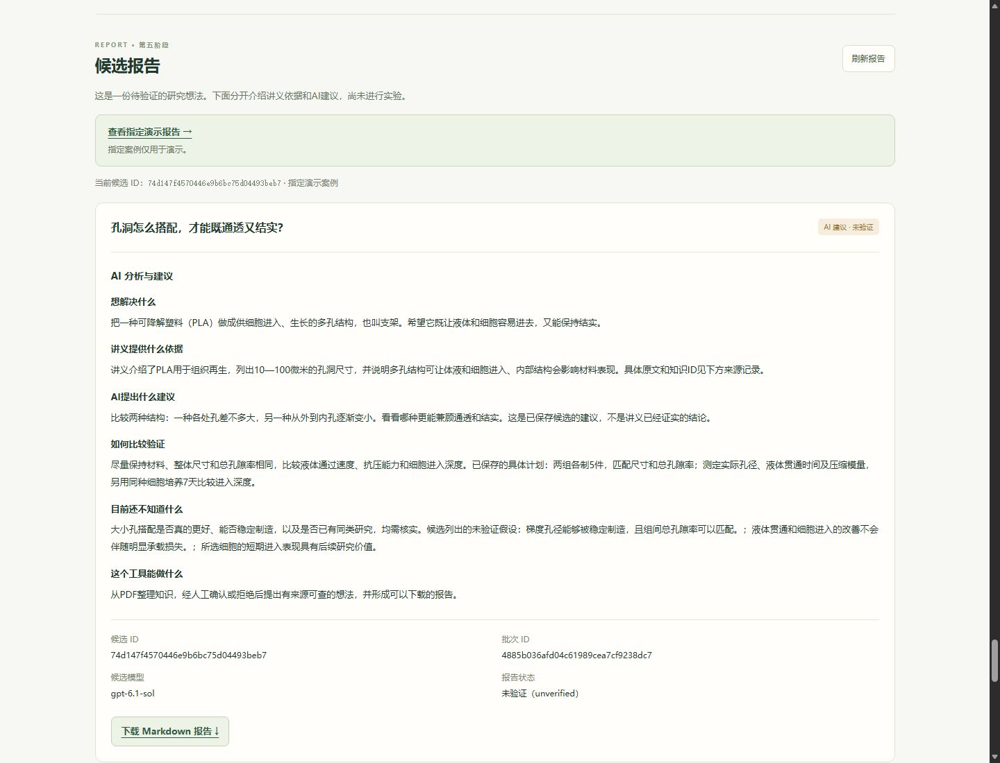

# CrossLink AI

**以跨领域关系探索为方法，先帮助技术团队从需求证据中发现应用机会和升级方向。**

## 总体目标与第一个应用场景

CrossLink AI的总体目标是：连接不同领域资料中的知识和对象，通过关系探索、多关系组合推理与反馈更新，提出可解释、可追溯、值得验证的机会。

第一个应用场景是需求与技术能力匹配。服务对象是有技术、但不确定应用方向或迭代方向的团队。系统计划持续积累允许使用的公开求助、评论等需求线索；团队提供技术简介，由系统追问关键能力与限制，经团队确认后，再与需求条件对照。

两者的关系是“总体方法与具体应用”：这里连接的是用户任务、使用场景、需求证据、技术能力和限制条件。今后也可以探索研究选题或方法迁移等其他场景，本次设计先围绕技术团队讲清楚。

## 希望交付的判断

- **应用机会：** 现有技术可能帮助哪些具体用户完成什么任务？有哪些支持证据，哪些条件尚未核实？
- **能力缺口：** 哪些需求与当前技术不匹配？补齐哪个能力，可能打开哪些用途？
- **停止或待查：** 需求线索太弱、存在条件冲突或关键能力未知时，明确说明，允许不推荐。

这些是待验证的产品能力，不承诺发现独创方案或直接证明商业价值。公开吐槽是线索，“用户没找到办法”也不等于市场上没有办法。

## 三个核心能力如何落地

| 原始核心 | 在首个应用中的具体作用 |
|---|---|
| 关系探索 | 找到原始表达、具体任务、使用条件、技术能力与限制之间的连接，并附上证据 |
| 多关系组合推理 | 串起“任务→所需能力→技术是否满足→可能方案”，检查硬性条件，标明推断与缺口 |
| 反馈驱动改进 | 保存技术测试和用户核实结果，修正需求分组、能力条件和匹配关系，保留新旧版本 |

## 一个直观的设计例子

以下是虚构的目标功能示例，不是实际抓取、用户访谈或模型实测结果。

假设公开求助提到“每天手工录入仪表数字”，其中有人必须在无网络现场工作，有人在可联网办公室工作。团队确认其技术可以读取清晰的印刷数字，但当前必须联网。

系统应把两种使用条件分开：办公室场景可以进入样本测试；无网络现场与现有能力冲突，应列为不匹配。若存在足够可靠的需求证据，可以把“离线运行”作为待评估的升级方向，并列出设备性能、准确率、成本等验证缺口，不能直接断言值得开发。

[完整产品方案](docs/PRODUCT_AND_DATA_DESIGN.md) · [数据关系与编排设计](docs/DATA_RELATIONS.md)

## 当前已经实现的原型

当前程序版本为0.5.0，已运行的是：

**PDF资料 → 带原文的知识 → 人工确认或拒绝 → 单一讲义的机会候选 → 报告查看与下载。**

1. PDF上传、按页阅读、原文件保存与页码追溯。
2. 使用已配置的Thingo接口，处理指定MIT医用材料讲义第1、5、10页。
3. 保存知识与审核状态，生成时仅使用已确认知识。
4. 保存候选、引用与输入快照，来源变化后提示重新核对。
5. 查看网页报告、下载Markdown；查看和下载不新增模型调用。

上述MIT案例验证基础处理流程，不是需求—技术匹配的实测。**公开平台数据接入、定时需求积累、需求归类、技术能力追问、条件匹配和升级建议均尚未实现。** 对象关系基础表已定义，但还没有贯通真实关系探索和组合路径。



## 仓库内容

- [产品方案](docs/PRODUCT_AND_DATA_DESIGN.md)：定位、两条工作流程、完整案例、反馈和实现边界。
- [数据关系与编排设计](docs/DATA_RELATIONS.md)：对象、关系、证据状态、条件匹配和框架衔接。
- `backend/`、`frontend/`：当前原型程序和测试。
- [源码快照清单](docs/SOURCE_MANIFEST.json)：原始及提交副本的程序文件指纹。

## 技术结构

前端React + TypeScript + Vite；后端FastAPI；本地SQLite；服务端通过Thingo适配器调用模型。需求匹配设计沿用数据对象、关系、编排与反馈的思路；老师框架的具体接口集成尚未完成。

## 安装和启动

此前本机验证环境：Windows、Python 3.14.3、Node 24.18.0。全新安装和其他环境尚未完整验证。

从仓库根目录安装后端：

```powershell
python -m venv backend/.venv
backend/.venv/Scripts/python.exe -m pip install -r backend/requirements.lock.txt
```

在另一个终端从仓库根目录安装前端：

```powershell
cd frontend
npm ci
```

分别从仓库根目录打开两个终端，启动后台和网页：

```powershell
cd backend
.\.venv\Scripts\python.exe -B -m uvicorn app.main:app --host 127.0.0.1 --port 8000
```

```powershell
cd frontend
npm run dev
```

网页：http://127.0.0.1:5173 。后台健康检查：http://127.0.0.1:8000/api/health 。启动与PDF上传阅读不需要模型密钥。

## 模型配置

需要真实模型调用时，将根目录`.env.example`复制为`.env`，只在本地填写自己的密钥，不提交到仓库。当前适配器实现指定Thingo国际站非流式聊天端点；模型可用性和费用以平台实际情况为准。

## 新环境演示限制

仓库不含密钥、运行数据库、原PDF、浏览器资料或安装后的依赖。新环境首次启动是空数据库，不会自动出现原机的15条知识和3条候选。

**当前提取仍绑定既有MIT文档ID，演示报告也依赖固定候选ID。上传任意PDF或填写密钥，不能直接重现原机完整案例。可携带的样本初始化尚未完成。** 截图展示原机已保存结果，不代表克隆后会自动生成。

原机报告入口：`http://127.0.0.1:5173/?report=74d147f4570446e9b6bc75d04493beb7#report`，依赖原机数据。

样本来源：MIT OpenCourseWare，3.051J，Spring 2006，Lecture 1。[原始讲义](https://www.ocw.mit.edu/courses/3-051j-materials-for-biomedical-applications-spring-2006/860c4719a25cc2154e95f27165c8bbbe_lecture1.pdf)。仓库只提供来源，不打包整份讲义。

## 检查

从仓库根目录分别执行：

```powershell
cd backend
.\.venv\Scripts\python.exe -B -m unittest discover -s tests -v
```

```powershell
cd frontend
npm run build
```

原机源版本此前通过21项后端测试及前端检查/构建，这是历史验证记录；提交副本尚未完成全新环境的安装和全流程回归。`backend/scripts/`中的验收脚本依赖原机数据，部分还需要已配置的Edge/CDP，不是新克隆安装步骤。

## 后续路线

1. 补齐基础样本初始化与任意资料处理，使演示可复现。
2. 选择一个细分任务、可靠数据来源和真实技术团队，验证需求提炼与条件匹配。
3. 保存显式关系和组合路径，区分应用机会、能力缺口与不匹配原因。
4. 接入实际反馈，检查下一版判断是否改善；再完善批量审核和详情展开。
