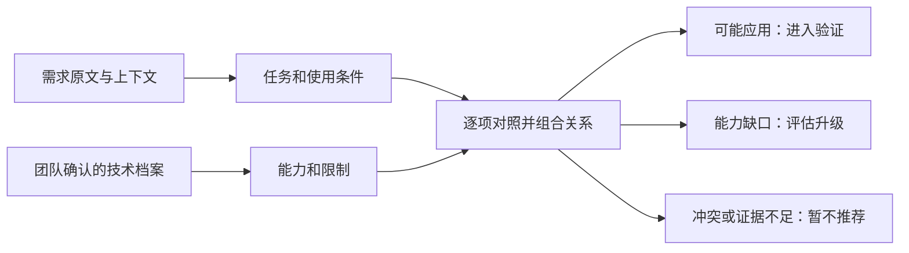
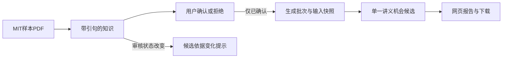

# 数据关系与编排设计

## 一、总体方法与应用对象

总体方法保留跨领域关系探索、多关系组合推理与反馈更新。首个应用把需求侧的任务与条件，连接到技术侧的能力与限制，形成可追溯的应用或升级假设。

本文沿用[产品方案](PRODUCT_AND_DATA_DESIGN.md)的仪表读数案例。S-01、S-02、S-03、T-01等均为虚构设计记录，没有实际采集或测试；目标数据结构与当前MIT原型分别说明。

## 二、目标数据对象

| 对象 | 主要字段 | 用途 |
|---|---|---|
| 来源记录 | ID、允许使用的来源、链接或导入位置、发布时间、采集时间、原文、上下文、重复关系 | 保留原始表达，不把模型解释当原话 |
| 证据 | 来源ID、原文片段、定位、类型、更新时间 | 支持具体陈述、条件或反例 |
| 需求线索 | 人群、场景、任务、障碍、现有办法、损失及未知项 | 描述从原文提炼的问题假设 |
| 需求条件组 | 任务、关键条件、关联线索、独立性判断、反例、核实范围 | 按任务和条件组织线索，不能仅按词或热度合并 |
| 技术档案 | 团队、能力、输入输出、限制、支持环境、测试依据、确认状态、版本 | 系统追问后由团队确认；未知参数保持未知 |
| 条件 | 类型、值或范围、单位、硬性要求或偏好、依据、未知状态 | 对照联网、精度、时延、成本等要求 |
| 关系 | 起点、终点、类型、证据、推断理由、适用条件、状态、版本 | 记录任务、能力及约束的连接 |
| 匹配路径 | 需求组、技术版本、关系集合、条件对照、冲突与缺口 | 解释匹配、暂不匹配或未知的原因 |
| 机会候选 | 问题、方案假设、引用路径、潜在价值、验证步骤、状态 | 表达待验证的应用机会 |
| 能力缺口 | 未满足条件、关联需求组、证据、其他障碍、验证与研发成本未知项 | 提出可调查的升级方向，不自动等于研发优先级 |
| 反馈事件 | 目标记录、用户原话或测试结果、条件与样本范围、时间、处理状态 | 修正判断并保留反馈原始范围 |
| 更新或生成批次 | 输入快照、能力与约束版本、采用的反馈、模型、状态、用量 | 复现判断、追踪变化、避免误复用旧结果 |

## 三、证据状态如何区分

记录至少区分三个维度，不能用一个“可信度分数”混在一起：

1. **表达证据：** 原文是否确实存在，来自什么时间与上下文，是否重复。
2. **需求判断：** 哪些任务、损失和未解决情况由原文明说，哪些是系统推测，哪些经过后续核实。
3. **技术适配：** 能力由团队确认还是由测试支持，是否满足该场景条件，哪些仍未知。

“有原文”不证明原文中的所有说法属实；多条表达不自动证明市场规模；有相似任务也不证明采用意愿。系统保留核实范围与未知项，而不是把线索直接升级成已验证需求。

## 四、仪表案例的显式关系

| 编号 | 关系 | 依据与性质 | 结果 |
|---|---|---|---|
| R-01 | S-01→描述→无网络现场的手工读数录入任务N-01 | 虚构示例中的原话支持；损失描述仍需核实 | 保存任务、离线条件与时间线索 |
| R-02 | S-02→描述→可联网办公室录入任务N-02 | 虚构示例中的原话支持 | 与N-01关联为同类任务，但分条件组 |
| R-03 | T-01→具备→清晰印刷数字识别与批量处理 | 虚构的团队确认，具体样本表现待测 | 允许形成待验证的能力关系 |
| R-04 | T-01→要求→联网运行 | 虚构的团队限制 | 与N-01离线条件硬性冲突 |
| R-05 | T-01→可能适用→N-02 | AI匹配假设，组合R-02、R-03及联网条件 | 进入样本验证，不能标为已解决 |
| R-06 | 离线能力缺口→关联→N-01 | 基于R-01与R-04的升级假设 | 需核实需求、设备与实现成本 |
| R-07 | S-03→提供反例→并非全部读数录入者都存在强需求 | 虚构原话支持 | 不把技术能做当作用户需要 |

匹配路径P-01记录N-02→所需识别能力→T-01对应能力→运行条件可兼容→精度与总处理负担待测。P-02记录N-01→离线要求→T-01必须联网→当前冲突→离线升级假设。不能用其他软性优点抵消硬性冲突，也不能把未知条件当作已满足。

## 五、两条目标编排流程

### 持续积累流程

获准使用的来源更新→保存原始记录→重复与独立性判断→提炼任务及条件→核对证据→更新需求条件组及反例→保留版本。

定时更新仅处理已经配置且允许使用的来源，记录覆盖范围、失败和更新时间。记录删除、失效或不再可用时标注相应状态，不继续把过期证据当作当前结论。

### 技术咨询流程

技术简介→追问未知关键参数→团队确认能力与限制→检索需求条件组→硬性条件检查→组合路径与证据缺口→输出应用或升级候选→团队核实与测试→反馈更新。

追问优先针对会改变筛选结果的条件，避免先填写大量无关字段。关键未知无法消除时，输出“需补证据”，而非强行推荐。

## 六、反馈如何传播到下一版

以虚构反馈F-01“办公室样本普遍反光，纠错后比手工慢”为例：

1. 保存原始测试反馈、样本与条件范围，关联技术版本和候选。
2. 不删除用户的录入问题；需求存在与当前技术能否解决是两种判断。
3. 修订与这些测试条件有关的反光能力、处理成本及匹配关系，将受影响路径和候选标为待复核。
4. 保留旧版本与修改理由，其他条件下的候选不应被无差别否定。
5. 新批次携带反馈和能力版本，提出补测、图像获取调整或能力改进假设，再与旧版比较。

反过来，如果核实发现用户每周仅录几项、手工负担很低，应修订需求判断，不能仅因技术可用就保留高优先级机会。不同来源的表述若后来发现是同一条转发，应修订独立性记录并标出受影响判断。

相同完整输入与约束可以复用批次；数据、能力或反馈变化后，不能误复用旧结果。持续改进依靠证据与版本更新，不预设自动训练模型，也不保证每次修改都更好。

## 七、与老师框架的概念衔接

| 目标设计 | 拟使用的框架概念 |
|---|---|
| 来源、任务、需求条件组、技术能力、候选 | 数据对象 |
| 原文支持、任务需要、技术具备、条件冲突、可能适用 | 数据关系 |
| 积累、提取、核对、检索、条件检查、组合、生成 | 数据编排步骤 |
| 核实结果、测试结果、关系修订、版本与依赖影响 | 对象状态与反馈更新 |

实际字段、接口与执行方式需核实原版框架后确定，目前不是已完成集成。

## 八、当前原型已经实现什么

当前知识保存文档ID、PDF实际页码、引句和审核状态；候选引用知识ID，批次保存当时快照。引句匹配仅校验出处，不证明候选有效。

原型已定义`data_schemas`、`data_objects`、`evidence`、`relations`、`object_evidence`及`relation_evidence`基础表。2026-11-20此前只读检查时这些表均为空，知识与候选使用后续增加的表，尚未贯通目标关系模型。

| 能力 | 当前状态 |
|---|---|
| 平台数据接入、定时需求积累 | 未实现 |
| 需求任务与条件提取、分组及反例管理 | 未实现 |
| 技术追问、团队能力确认与条件匹配 | 未实现 |
| 独立关系写入、组合路径、应用与升级输出 | 未贯通真实流程 |
| 知识审核与候选来源变化提示 | 已有基础实现 |
| 需求与技术反馈事件、完整版本和影响传播 | 待实现 |

MIT原型说明基础流程已运行；仪表案例说明首个应用的目标设计。数据表、设计图和示例不能作为功能已完成的证据。
